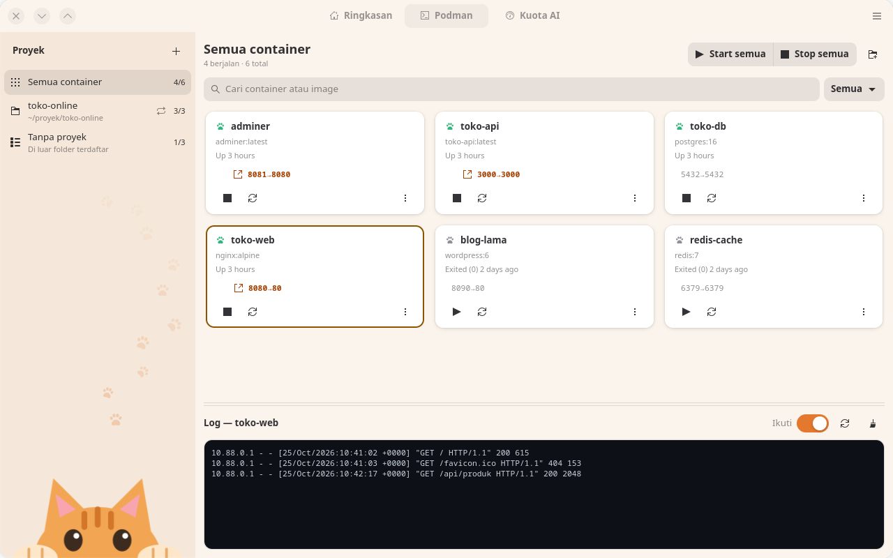
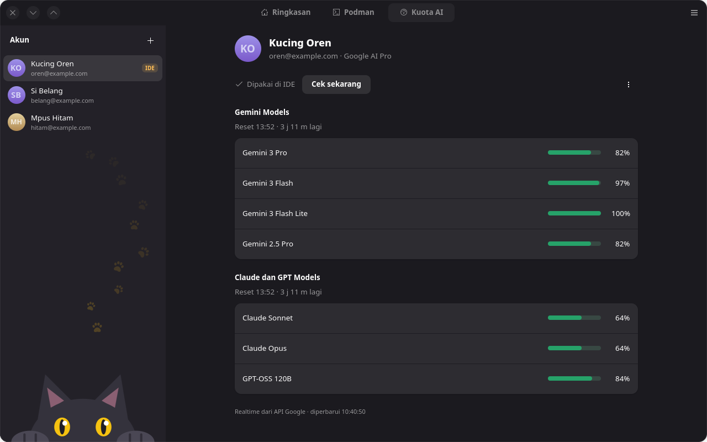
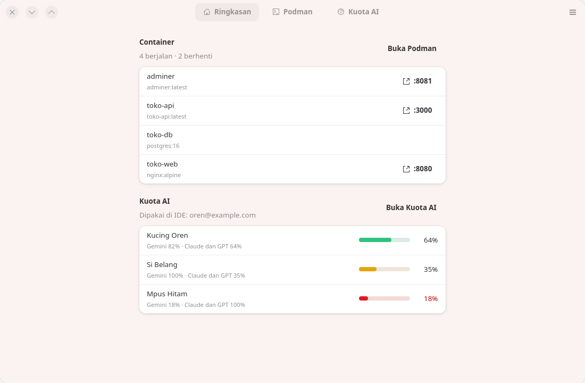
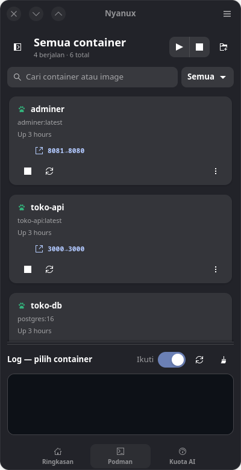
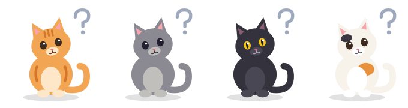

<p align="center">
  
</p>

<h1 align="center">Nyanux</h1>

<p align="center"><b>Biar nggak pusing ngurus Linux tanpa GUI.</b></p>

Banyak hal di Linux cuma bisa diurus lewat terminal: container, compose, port, log, token,
file konfigurasi. Semuanya bisa, tapi harus ingat perintahnya dan bolak-balik antar jendela.

**Nyanux** adalah aplikasi desktop kecil (GTK4 / Libadwaita) yang membungkus pekerjaan-pekerjaan
itu jadi tombol dan daftar yang jelas. Fiturnya sengaja tidak dibatasi: setiap kali ada urusan
terminal yang bikin pusing, ia bisa jadi tab baru di Nyanux.

## Tampilan



<table>
  <tr>
    <td></td>
    <td></td>
  </tr>
  <tr>
    <td align="center"><sub>Kuota AI · tema Hitam, mode gelap</sub></td>
    <td align="center"><sub>Ringkasan · tema Belang tiga</sub></td>
  </tr>
</table>

<p align="center">
  
  <br><sub>Jendela sempit · tema Abu</sub>
</p>

<p align="center">
  
  <br><sub>Tema kucing: Oren · Abu · Hitam · Belang tiga</sub>
</p>

<sub>Screenshot memakai data contoh.</sub>

## Fitur saat ini

### Podman
- Lihat semua container beserta status, image, dan port. Port web bisa langsung dibuka di browser.
- Start, stop, dan restart satu per satu atau sekaligus.
- Log container live, dengan opsi ikuti otomatis.
- **Proyek compose**: tambahkan folder (atau seret ke jendela). Folder induk dipindai otomatis.
  Ada tombol Up / Down / Restart, plus opsi jalankan otomatis saat Nyanux dibuka.
- **Ganti port tanpa edit file**:
  - Container compose: port disimpan di file override milik Nyanux.
  - Container `podman run`: dibuat ulang dari perintah aslinya. Kalau gagal, container lama dikembalikan.

### Kuota AI (Antigravity)
- Sisa kuota setiap model untuk banyak akun Google, diambil realtime dari API.
  IDE dan browser tidak perlu dibuka.
- Token di-refresh otomatis. Akun yang sesinya habis diberi tanda dan tombol **Login ulang**.
- Pindahkan akun yang dipakai Antigravity IDE dengan satu klik.

### Ringkasan
- Satu halaman berisi container yang sedang berjalan dan kuota terendah tiap akun.

### Ikon system tray
- Klik ikon Nyanux di tray untuk melihat container yang berjalan (buka web, lihat log,
  restart, stop), menjalankan container yang berhenti, dan sisa kuota tiap akun,
  tanpa membuka jendela.
- Tooltip menampilkan jumlah container berjalan dan kuota terendah.
- Menutup jendela tidak mematikan aplikasi; Nyanux tetap jalan di tray. Untuk benar-benar
  keluar, pilih **Keluar** (atau Ctrl+Q). Perilaku ini bisa dimatikan di Preferensi.
- Didukung KDE Plasma, Cinnamon, XFCE, dll. GNOME butuh ekstensi
  *AppIndicator and KStatusNotifierItem Support*.

Tampilannya menyesuaikan ukuran jendela: di layar lebar ada sidebar; di jendela sempit sidebar
jadi panel geser dan navigasi pindah ke bawah. Tema mengikuti sistem, atau bisa diatur sendiri.

### Tema kucing
Pilih jenis kucing di **Preferensi → Tema kucing**: **Oren**, **Abu**, **Hitam**, **Belang tiga**,
atau **Bawaan sistem**. Tema mengubah warna aksen dan nuansa latar (terang maupun gelap),
sekaligus warna bulu kucing di ilustrasi: kucing tidur di kardus saat halaman kosong, kucing
bingung saat pencarian tidak ketemu, dan kucing kecil yang mengintip di bawah sidebar
(bisa dimatikan lewat **Hiasan kucing**).

## Kebutuhan

- Python 3.10+
- GTK 4 dan libadwaita ≥ 1.6 beserta PyGObject (sudah ada di GNOME terbaru, Fedora, Bazzite, dll.)
- `podman` untuk tab Podman. `podman-compose` opsional; tanpanya dipakai `podman compose`.

## Pasang

```bash
git clone <url-repo> nyanux
cd nyanux
./install.sh
```

Setelah itu Nyanux muncul di menu aplikasi, dan bisa juga dijalankan dari terminal dengan `nyanux`.
Untuk mencoba tanpa memasang: `python3 nyanux.py`.

Hapus pemasangan dengan `./install.sh --uninstall`. Pengaturan di `~/.config/nyanux` tidak ikut dihapus.

### Client OAuth untuk Kuota AI

Untuk login akun Google dan me-refresh token, Nyanux butuh client ID & secret OAuth
Antigravity. Nilainya **tidak disimpan di repo**. Isi salah satu:

- File `~/.config/nyanux/oauth_clients.json` (sebaiknya `chmod 600`):

  ```json
  {
    "clients": [
      { "name": "Antigravity IDE", "client_id": "…apps.googleusercontent.com", "client_secret": "…" }
    ]
  }
  ```

  Client pertama dipakai untuk login baru. Client berikutnya hanya dipakai untuk me-refresh
  token akun lama yang dibuat dengan client tersebut.

- Atau env var `ANTIGRAVITY_OAUTH_CLIENT_ID` dan `ANTIGRAVITY_OAUTH_CLIENT_SECRET`
  (diprioritaskan di atas file).

Tanpa ini, tab Podman tetap berjalan normal. Di tab Kuota AI, akun yang sudah login di Antigravity
IDE tetap terbaca, tapi tombol **Tambah akun** akan menampilkan petunjuk pengaturan.

## Struktur kode

| File | Isi |
|---|---|
| `nyanux.py` | Jendela utama, navigasi, breakpoint layar, preferensi |
| `dashboard_tab.py` | Halaman Ringkasan |
| `podman_tab.py` | Tampilan tab Podman |
| `podman_projects.py` | Logika Podman tanpa GTK: proyek compose, override port |
| `ag_kuota_tab.py` | Tampilan tab Kuota AI |
| `ag_kuota_backend.py`, `ag_kuota_live.py` | Akun, cache, dan API kuota Google Cloud Code |
| `tray.py` | Ikon & menu system tray (StatusNotifierItem lewat D-Bus, tanpa GTK3) |
| `themes.py` | Tema kucing: palet warna & ilustrasi SVG yang diwarnai sesuai tema |
| `icons/` | Ikon aplikasi (berwarna & simbolik) |

## Menambah fitur

Setiap fitur adalah satu tab:

1. Buat modul baru, misalnya `systemd_tab.py`, berisi satu widget GTK
   (`class SystemdTab(Gtk.Box)` yang menerima `main_win`).
2. Taruh logika yang tidak butuh GTK (menjalankan perintah, membaca file) di modul terpisah,
   supaya mudah diuji.
3. Daftarkan di `nyanux.py`, di `_build_ui`, lewat `self.content_stack.add_titled_with_icon(...)`.

Pekerjaan berat (memanggil perintah, jaringan) jalankan di thread, lalu perbarui UI lewat
`GLib.idle_add` supaya jendela tidak macet.

## Data yang disimpan

- `~/.config/nyanux/`: pengaturan, daftar proyek Podman, override port, client OAuth.
- `~/.config/gemini-quota-monitor/accounts.json`: akun dan token kuota. **Berisi token login, jangan dibagikan.**

## Lisensi

[MIT](LICENSE): bebas dipakai, diubah, dan dibagikan, asal pemberitahuan hak cipta tetap disertakan.
